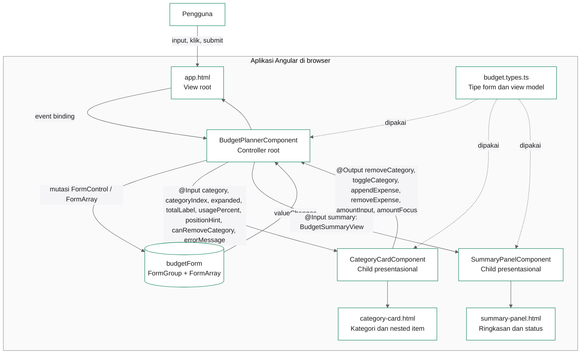

# Component Architecture

Diagram ini menunjukkan pembagian tanggung jawab antara root controller dan dua child component presentasional. Tidak ada service, backend, atau state management eksternal.

## Aturan arsitektur

- Root adalah satu-satunya pemilik state bisnis: `budgetForm`, snapshot ringkasan, `collapsedCategories`, validator, dan kalkulasi.
- `CategoryCardComponent` menerima `CategoryGroup` dan data tampilan; semua aksi dikirim ke root melalui `EventEmitter`.
- `SummaryPanelComponent` hanya menerima satu `BudgetSummaryView`; tidak ada kalkulasi di dalam child.
- `budget.types.ts` menjadi kontrak tipe bersama agar root dan child memakai bentuk data yang sama.
- Root memakai `ViewEncapsulation.None`, sehingga `app.css` menjadi stylesheet global untuk root dan child; selector level halaman memakai `app-root`.
