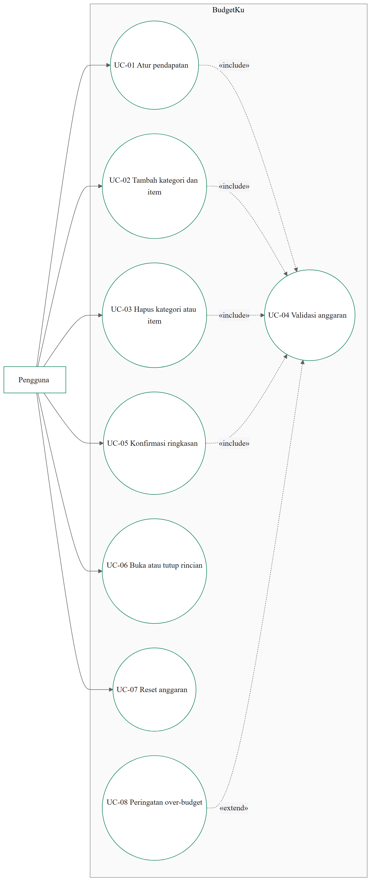
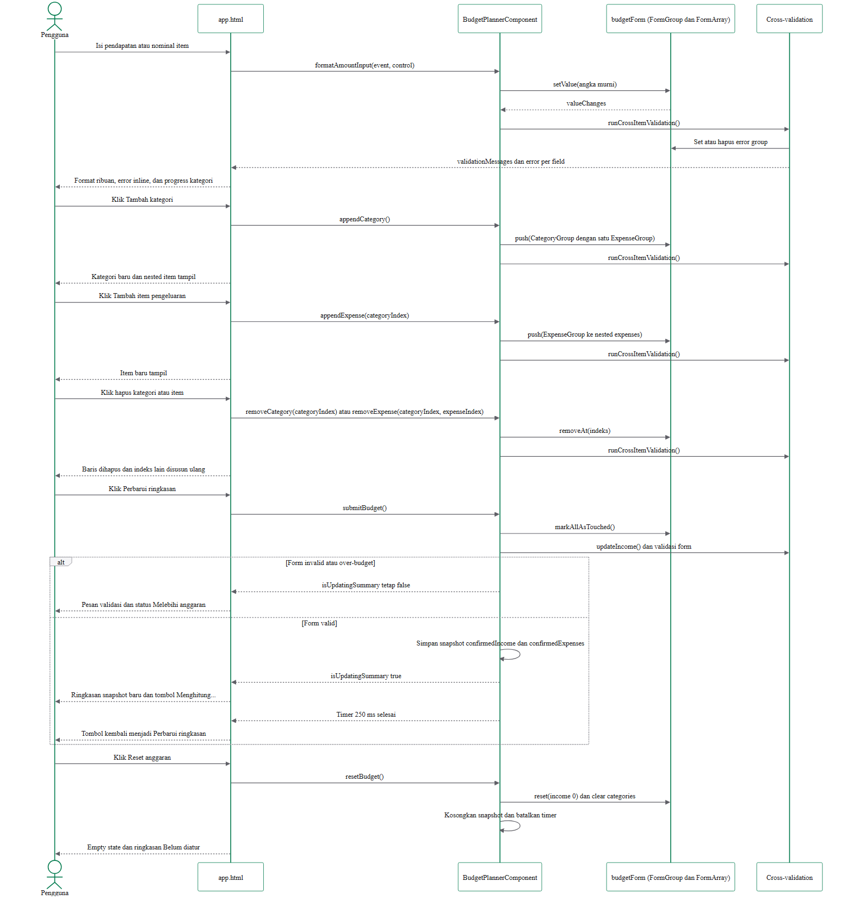
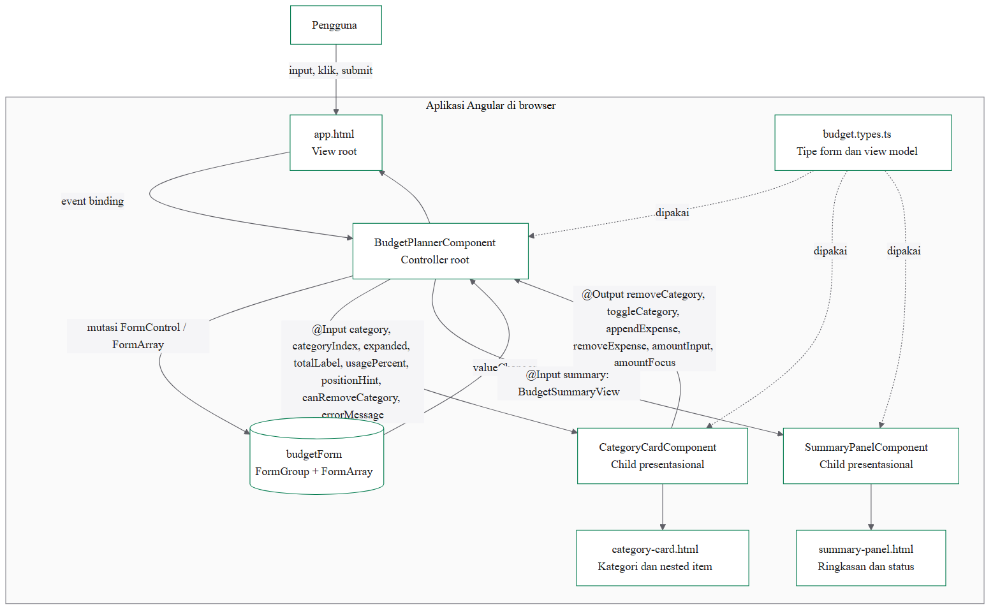

# LAPORAN UTS FRAMEWORK BASED PROGRAMMING

## BudgetKu: Perencana Anggaran Bulanan Interaktif

**Mata kuliah:** Framework Based Programming<br>
**Dosen:** Halimatuz Zuhriyah, S.Kom., MIT<br>
**Jurusan:** Teknik Informatika<br>
**Semester:** Ganjil TA. 2026/2027

| Identitas | Isi |
| --- | --- |
| Nama lengkap | Rifat Dhiya Ul Lail |
| NPM | 092024090441 |
| Kelas | TI Pagi |
| Studi kasus | BudgetKu, perencana anggaran bulanan |
| Repository | `https://github.com/Rifatdhy/BudgetKU` |

---

## Daftar Isi

1. Studi Kasus dan Use Case Diagram
2. Use Case Description
3. Sequence Diagram View–Controller
4. Component Architecture dan Data Mapping
5. Implementasi FormArray dan Cross-Validation
6. Implementasi `*ngFor`, Context Variable, `trackBy`, dan Nested Loop
7. Implementasi `*ngIf`, Template Branching, dan UI State
8. Tampilan, Aksesibilitas, dan Responsivitas
9. Pengujian
10. Skenario Live Demo dan Technical Defense
11. Kesimpulan
12. Lampiran

---

## 1. Studi Kasus dan Use Case Diagram

### 1.1 Latar belakang

Banyak orang kesulitan melihat ke mana uang bulanannya pergi karena catatan pengeluaran masih tersebar di catatan kecil atau aplikasi yang terlalu rumit. BudgetKu dibuat sebagai perencana anggaran bulanan yang interaktif: pengguna memasukkan pendapatan, menyusun kategori pengeluaran, lalu menambahkan beberapa item di dalam setiap kategori.

Aplikasi ini bukan CRUD statis. Setiap perubahan input langsung memengaruhi kalkulasi area kerja: total per kategori, total seluruh pengeluaran, sisa anggaran terhadap pendapatan, persentase pemakaian, progress bar, serta status `Aman`, `Mendekati batas`, atau `Melebihi anggaran`. Validasi lintas baris juga berjalan langsung, misalnya larangan nama kategori duplikat, larangan nama item duplikat dalam satu kategori, dan batas total pengeluaran terhadap pendapatan.

### 1.2 Aktor dan batasan

- **Aktor:** Pengguna.
- **Fokus:** lapisan View (template HTML) dan Controller (component TypeScript).
- **Tanpa backend:** tidak ada API, database, login, atau penyimpanan permanen. Data hanya bertahan selama halaman terbuka.
- **Teknologi:** Angular standalone component, Reactive Forms, TypeScript strict, Karma/Jasmine, dan Playwright.

### 1.3 Fungsi utama

| ID | Use case | Hasil |
| --- | --- | --- |
| UC-01 | Mengatur pendapatan bulanan | Pendapatan menjadi batas perhitungan anggaran. |
| UC-02 | Menambah kategori dan item pengeluaran | Kategori baru dan item bertingkat masuk ke `FormArray`. |
| UC-03 | Menghapus kategori atau item | Baris dihapus pada indeks tertentu tanpa merusak urutan. |
| UC-04 | Memvalidasi anggaran | Input wajib, nilai minimum, duplikasi, dan batas anggaran diperiksa. |
| UC-05 | Mengonfirmasi ringkasan anggaran | Snapshot total, sisa, pemakaian, dan status diperbarui. |
| UC-06 | Membuka atau menutup rincian kategori | Rincian item dapat disembunyikan dan ditampilkan kembali. |
| UC-07 | Mereset anggaran | Form, validasi, dan snapshot kembali ke kondisi awal. |
| UC-08 | Menampilkan peringatan over-budget | Status draf `Melebihi anggaran` muncul tanpa mengubah snapshot. |

### 1.4 Relasi use case

| Relasi | Dari | Ke | Alasan |
| --- | --- | --- | --- |
| `«include»` | UC-01 Atur pendapatan | UC-04 Validasi anggaran | Setiap perubahan pendapatan selalu menjalankan validasi. |
| `«include»` | UC-02 Tambah kategori dan item | UC-04 Validasi anggaran | Setiap penambahan baris selalu divalidasi. |
| `«include»` | UC-03 Hapus kategori atau item | UC-04 Validasi anggaran | Penghapusan memicu validasi ulang baris yang tersisa. |
| `«include»` | UC-05 Konfirmasi ringkasan | UC-04 Validasi anggaran | Ringkasan hanya dikonfirmasi setelah form valid. |
| `«extend»` | UC-08 Peringatan over-budget | UC-04 Validasi anggaran | Peringatan hanya muncul bila total melebihi pendapatan. |

Arah `«include»` selalu dari use case dasar menuju use case yang selalu disertakan. Arah `«extend»` selalu dari use case perluasan menuju use case dasar, sesuai kaidah UML.

### 1.5 Diagram use case



Sumber Mermaid: `docs/uts/use-case-diagram.md`. Berkas PNG dan PDF tersedia di folder yang sama.

---

## 2. Use Case Description

Use case description berikut menjabarkan aktor, tujuan, precondition, alur aksi–reaksi View–Controller, skenario alternatif saat validasi gagal, dan postcondition.

### 2.1 UC-01: Mengatur pendapatan bulanan

| Elemen | Deskripsi |
| --- | --- |
| Nama use case | UC-01 Mengatur pendapatan bulanan |
| Aktor | Pengguna |
| Tujuan | Menentukan batas anggaran bulanan. |
| Precondition | Halaman BudgetKu terbuka dan `budgetForm` sudah dibuat. |
| Alur utama | 1. Pengguna mengetik nominal pada input `Pendapatan bulanan`.<br>2. View menjalankan `(input)` dan memanggil `formatAmountInput(event, incomeControl)`.<br>3. Controller menyimpan angka murni ke `income` dan menampilkan format ribuan.<br>4. View menjalankan `(blur)` dan memanggil `updateIncome()`.<br>5. Controller menandai kontrol sebagai touched lalu menjalankan `runCrossItemValidation()`.<br>6. Getter `getCategoryUsagePercent()`, `calculateTotalExpenses()`, dan `getBudgetStatus()` menghitung ulang tampilan area kerja. |
| Skenario alternatif | Jika nilai kosong atau `0`, `income` menjadi invalid. Pesan `Pendapatan wajib lebih besar dari Rp0.` tampil setelah kontrol touched atau dirty, dan `submitBudget()` tidak mengonfirmasi ringkasan. |
| Postcondition | Nilai `income` tersimpan di state lokal. Area kerja mengikuti nilai form, sedangkan ringkasan tetap memakai snapshot sampai dikonfirmasi. |

### 2.2 UC-02: Menambah kategori dan item pengeluaran

| Elemen | Deskripsi |
| --- | --- |
| Nama use case | UC-02 Menambah kategori dan item pengeluaran |
| Aktor | Pengguna |
| Tujuan | Menyusun pengeluaran bertingkat dengan kategori dan item. |
| Precondition | Halaman BudgetKu terbuka. |
| Alur utama | 1. Pengguna menekan `Tambah kategori` atau `Tambah kategori pertama`.<br>2. View memanggil `appendCategory()`.<br>3. Controller memeriksa `maxCategories`, lalu mendorong `createCategoryGroup()` ke `categories`.<br>4. View menampilkan `CategoryCardComponent` baru dengan satu item awal.<br>5. Pengguna menekan `Tambah item pengeluaran`.<br>6. Child memancarkan `appendExpense` melalui `EventEmitter`, lalu root memanggil `appendExpense(categoryIndex)`.<br>7. Controller mendorong `createExpenseGroup()` ke nested `expenses` dan menjalankan `runCrossItemValidation()`. |
| Skenario alternatif | Jika jumlah kategori sudah `10`, `appendCategory()` menolak penambahan dan menampilkan `Maksimal 10 kategori diperbolehkan.` Jika nama kategori atau nama item duplikat, error group dan pesan validasi ditampilkan tanpa menghapus data yang sudah ada. |
| Postcondition | `categories` dan nested `expenses` berisi data baru. Total area kerja berubah real-time, sedangkan snapshot ringkasan tetap sampai dikonfirmasi. |

### 2.3 UC-05: Mengonfirmasi ringkasan anggaran

| Elemen | Deskripsi |
| --- | --- |
| Nama use case | UC-05 Mengonfirmasi ringkasan anggaran |
| Aktor | Pengguna |
| Tujuan | Memperbarui total, sisa, persentase, dan status ringkasan dari data yang valid. |
| Precondition | Form berisi pendapatan valid, minimal satu kategori, dan item dengan nominal valid. |
| Alur utama | 1. Pengguna menekan `Perbarui ringkasan`.<br>2. View menjalankan `(ngSubmit)` dan memanggil `submitBudget()`.<br>3. Controller menjalankan `markAllAsTouched()` dan `updateIncome()`.<br>4. Jika valid, Controller menyimpan `confirmedIncome` dan `confirmedExpenses` dari nilai form.<br>5. Controller membentuk `summaryView` dari `getBudgetStatus()`, `formatRupiah()`, dan `budgetUsagePercent`.<br>6. `SummaryPanelComponent` menerima `@Input summary` dan menampilkan sisa, total, progress, serta status.<br>7. Controller menyalakan `isUpdatingSummary` selama 250 ms dan View menampilkan `Menghitung...`. |
| Skenario alternatif | Jika form invalid atau over-budget, `submitBudget()` langsung kembali tanpa mengubah snapshot dan tanpa menyalakan `Menghitung...`. Pengguna melihat pesan validasi dan status draf `Melebihi anggaran`. |
| Postcondition | Snapshot ringkasan berisi data terkonfirmasi terbaru. Perubahan form berikutnya tidak mengubah ringkasan sampai tombol ditekan lagi. |

### 2.4 UC-04 dan UC-08: Validasi dan peringatan over-budget

| Elemen | Deskripsi |
| --- | --- |
| Nama use case | UC-04 Memvalidasi anggaran, diperluas oleh UC-08 Peringatan over-budget |
| Aktor | Pengguna |
| Tujuan | Mencegah data tidak lengkap, duplikat, atau melebihi pendapatan. |
| Precondition | Form berisi pendapatan, kategori, dan item. |
| Alur utama | 1. Setiap perubahan nilai memicu `valueChanges`.<br>2. Controller menjalankan `runCrossItemValidation()`.<br>3. Controller memeriksa nama kategori duplikat, nama item duplikat per kategori, jumlah item minimal satu, dan total pengeluaran terhadap pendapatan.<br>4. Pesan disimpan di `validationMessages`; error group dipasang pada kontrol terkait.<br>5. View menampilkan pesan inline dan panel `role="alert"`. |
| Skenario alternatif | Jika total pengeluaran melebihi pendapatan, `UC-08` berjalan: `isDraftOverBudget` menjadi benar, `validationHeading` mengembalikan `Melebihi anggaran`, dan pesan `Total pengeluaran tidak boleh melebihi pendapatan bulanan.` tampil. Snapshot ringkasan tidak berubah. |
| Postcondition | Kondisi valid atau tidak valid terlihat langsung di area kerja. Ringkasan tetap memakai snapshot terakhir yang valid. |

### 2.5 Use case pendukung

| Use case | Ringkasan alur | Alternatif |
| --- | --- | --- |
| UC-03 Menghapus kategori atau item | Child memancarkan `removeCategory` atau `removeExpense`, root memanggil `removeAt(indeks)`, lalu validasi dan total dihitung ulang. | Tombol hapus kategori nonaktif saat hanya satu kategori; tombol hapus item nonaktif saat hanya satu item; indeks di luar rentang diabaikan. |
| UC-06 Membuka atau menutup rincian | Child memancarkan `toggleCategory`, root menambah atau menghapus referensi dari `collapsedCategories`, lalu mengirim `expanded` kembali sebagai `@Input`. | State collapsed tetap dipertahankan ketika baris lain berubah karena `trackBy` memakai identitas kontrol. |
| UC-07 Mereset anggaran | Root membatalkan timer, mereset `budgetForm`, mengosongkan `categories`, pesan validasi, dan snapshot. | Timer ringkasan yang masih berjalan dibatalkan agar state loading tidak tertinggal. |

---

## 3. Sequence Diagram View–Controller

### 3.1 Fokus diagram

Sequence diagram menggambarkan interaksi murni antara View dan Controller di browser. Tidak ada participant backend, database, repository, atau service eksternal. Pesan yang digambarkan mencakup:

- event binding dari input, klik, dan submit;
- pemanggilan handler di `BudgetPlannerComponent`;
- mutasi `FormControl` dan `FormArray` di memori;
- kalkulasi real-time `calculateTotalExpenses()`, `calculateRemainingBudget()`, `getBudgetStatus()`, `getCategoryTotal()`, dan `getCategoryUsagePercent()`;
- validasi lintas baris `runCrossItemValidation()`;
- re-render data ke `CategoryCardComponent` dan `SummaryPanelComponent` melalui `@Input`.

### 3.2 Diagram



Sumber Mermaid: `docs/uts/sequence-diagram.md`.

### 3.3 Sinkronisasi nama method

| Nama di diagram | Lokasi | Fungsi |
| --- | --- | --- |
| `formatAmountInput(event, control)` | `app.ts` | Menyimpan angka murni dan memformat ribuan. |
| `updateIncome()` | `app.ts` | Menandai income touched dan memvalidasi. |
| `appendCategory()` | `app.ts` | Menambah kategori baru. |
| `removeCategory(categoryIndex)` | `app.ts` | Menghapus kategori pada indeks tertentu. |
| `appendExpense(categoryIndex)` | `app.ts` | Menambah item pada kategori. |
| `removeExpense(categoryIndex, expenseIndex)` | `app.ts` | Menghapus item pada indeks tertentu. |
| `toggleCategory(category)` | `app.ts` | Membuka atau menutup rincian kategori. |
| `submitBudget()` | `app.ts` | Mengonfirmasi snapshot ringkasan bila valid. |
| `resetBudget()` | `app.ts` | Mengosongkan form, validasi, dan snapshot. |
| `calculateTotalExpenses()` | `app.ts` | Menghitung total seluruh item. |
| `calculateRemainingBudget()` | `app.ts` | Menghitung pendapatan dikurangi pengeluaran. |
| `getBudgetStatus()` | `app.ts` | Menentukan status anggaran. |
| `getCategoryTotal(category)` | `app.ts` | Menghitung total satu kategori. |
| `getCategoryUsagePercent(category)` | `app.ts` | Menghitung progress satu kategori. |
| `runCrossItemValidation()` | `app.ts` | Validasi lintas baris. |
| `trackByCategory` | `app.ts` | `trackBy` loop kategori. |
| `trackByExpense` | `category-card.ts` | `trackBy` loop item di child. |

### 3.4 Penjelasan real-time versus snapshot

Rubrik meminta kalkulasi real-time. BudgetKu memisahkan dua hal:

1. **Area kerja real-time.** Setiap perubahan nominal langsung mengubah total kategori, total pengeluaran, progress, sisa terhadap pendapatan, dan validasi. Ini yang ditunjukkan pada sequence diagram bagian input nominal.
2. **Ringkasan terkonfirmasi.** Panel ringkasan sengaja memakai snapshot `confirmedIncome` dan `confirmedExpenses` yang hanya diperbarui lewat `submitBudget()` yang valid. Tujuannya agar pengguna bisa membandingkan draf dengan anggaran yang sudah dikonfirmasi.

Pemisahan ini adalah keputusan desain yang dijelaskan di laporan dan dipertahankan pada pengujian. Dengan demikian, kalkulasi real-time tetap ada dan dapat didemokan, sementara ringkasan tidak berubah diam-diam saat pengguna masih mengedit.

---

## 4. Component Architecture dan Data Mapping

### 4.1 Component tree



```text
BudgetPlannerComponent (app.ts, selector app-root)
├── app.html
│   ├── Panel pendapatan
│   ├── CategoryCardComponent (diulang untuk setiap kategori)
│   │   └── category-card.html
│   │       └── nested FormArray expenses
│   └── SummaryPanelComponent
│       └── summary-panel.html
├── budget.types.ts
└── app.css
```

Root adalah satu-satunya pemilik state bisnis. `CategoryCardComponent` dan `SummaryPanelComponent` bersifat presentasional: menerima data siap tampil dan mengirim aksi ke root. Tidak ada state duplikat di child.

### 4.2 Pemetaan `@Input` dan `@Output`

| Komponen | Anggota | Jenis | Fungsi |
| --- | --- | --- | --- |
| `CategoryCardComponent` | `category` | `@Input` wajib | `FormGroup` satu kategori. |
| | `categoryIndex` | `@Input` | Nomor kategori dan ID kontrol. |
| | `expanded` | `@Input` | State buka/tutup rincian. |
| | `totalLabel` | `@Input` | Total kategori terformat. |
| | `usagePercent` | `@Input` | Progress kategori. |
| | `positionHint` | `@Input` | Hint posisi kategori. |
| | `canRemoveCategory` | `@Input` | Status tombol hapus kategori. |
| | `errorMessage` | `@Input` | Pesan error nama kategori. |
| | `removeCategory` | `@Output EventEmitter<number>` | Aksi hapus kategori. |
| | `toggleCategory` | `@Output EventEmitter<CategoryGroup>` | Aksi buka/tutup. |
| | `appendExpense` | `@Output EventEmitter<number>` | Aksi tambah item. |
| | `removeExpense` | `@Output EventEmitter<ExpenseRemoval>` | Aksi hapus item. |
| | `amountInput` | `@Output EventEmitter<AmountInputEvent>` | Event input nominal. |
| | `amountFocus` | `@Output EventEmitter<FocusEvent>` | Event fokus nominal. |
| `SummaryPanelComponent` | `summary` | `@Input` wajib | `BudgetSummaryView` berisi semua data ringkasan. |
| `BudgetPlannerComponent` | `budgetForm` | State root | `FormGroup` dengan `income` dan `categories`. |

### 4.3 Pemetaan elemen View ke Controller

| Elemen View | Controller | Mekanisme |
| --- | --- | --- |
| Input pendapatan | `incomeControl`, `formatAmountInput()`, `updateIncome()` | `formControlName`, `(input)`, `(blur)` |
| Tombol tambah kategori | `appendCategory()` | `(click)` |
| Nama kategori | `category.controls.name` | `formControlName` di child |
| Tombol buka/tutup | `toggleCategory()`, `isCategoryExpanded()` | `@Output` dan `@Input` |
| Tombol hapus kategori | `removeCategory(categoryIndex)` | `@Output` |
| Tombol tambah item | `appendExpense(categoryIndex)` | `@Output` |
| Nama pengeluaran | `expense.controls.name` | `formControlName` di child |
| Nominal | `expense.controls.amount`, `formatAmountInput()` | `formControlName`, `@Output amountInput` |
| Tombol hapus item | `removeExpense(categoryIndex, expenseIndex)` | `@Output` |
| Total kategori | `getCategoryTotal(category)` | `@Input totalLabel` |
| Progress kategori | `getCategoryUsagePercent(category)` | `@Input usagePercent` |
| Panel ringkasan | `summaryView` | `@Input summary` |
| Panel validasi | `validationMessages`, `validationHeading` | `*ngIf`, `*ngFor` |
| Tombol perbarui | `submitBudget()`, `submitLabel` | `(ngSubmit)` |
| Tombol reset | `resetBudget()` | `(click)` |

### 4.4 Alur data

```text
Pengguna berinteraksi dengan child
  → child memancarkan @Output
  → root memutasi FormControl / FormArray
  → validator dan kalkulasi root berjalan
  → root membentuk nilai @Input baru
  → child melakukan re-render tanpa menyimpan state bisnis
```

Saat submit valid, root menyimpan snapshot dan membentuk `BudgetSummaryView` baru untuk `SummaryPanelComponent`.

---

## 5. Implementasi FormArray dan Cross-Validation

### 5.1 Struktur form

```text
budgetForm: FormGroup
├── income: FormControl<number>
└── categories: FormArray<CategoryGroup>
    └── CategoryGroup
        ├── name: FormControl<string>
        └── expenses: FormArray<ExpenseGroup>
            └── ExpenseGroup
                ├── name: FormControl<string>
                └── amount: FormControl<number>
```

Tipe `CategoryGroup` dan `ExpenseGroup` didefinisikan sekali di `budget.types.ts` dan dipakai root maupun child.

### 5.2 Operasi dinamis

| Operasi | Method | Bukti |
| --- | --- | --- |
| Append kategori | `appendCategory()` | `categories.push(createCategoryGroup())` |
| Remove at index kategori | `removeCategory(categoryIndex)` | `categories.removeAt(categoryIndex)` dengan pemeriksaan indeks |
| Append item | `appendExpense(categoryIndex)` | `expenses.push(createExpenseGroup())` |
| Remove at index item | `removeExpense(categoryIndex, expenseIndex)` | `expenses.removeAt(expenseIndex)` dengan pemeriksaan indeks |
| Batas kategori | `maxCategories = 10` | Pesan `Maksimal 10 kategori diperbolehkan.` |

### 5.3 Validasi field

- `income`: `Validators.required` dan `Validators.min(1)`.
- Nama kategori: `Validators.required`.
- Nama item: `Validators.required`.
- Nominal item: `Validators.required` dan `Validators.min(1)`.

### 5.4 Validasi lintas baris

| Aturan | Implementasi |
| --- | --- |
| Nama kategori tidak boleh duplikat | `categoryNamesValidator()` pada `categories` dan `runCrossItemValidation()` untuk pesan. |
| Nama item tidak boleh duplikat dalam satu kategori | Set nama per kategori di `runCrossItemValidation()`. |
| Setiap kategori minimal satu item | Pemeriksaan `expenses.length === 0`. |
| Total tidak boleh melebihi pendapatan | `budgetLimitValidator()` dan `runCrossItemValidation()`. |
| Maksimal 10 kategori | `appendCategory()`. |

Validasi dijalankan di Controller, bukan di template. Template hanya membaca getter dan method tampilan.

---

## 6. Implementasi `*ngFor`, Context Variable, `trackBy`, dan Nested Loop

### 6.1 Context variable

| Variabel | Lokasi | Fungsi |
| --- | --- | --- |
| `categoryIndex` | Loop kategori di `app.html` | Nomor kategori, ID input, dan aria-label. |
| `first`, `last` | Loop kategori di `app.html` | `getPositionHint()` dan `canRemoveCategory()`. |
| `expenseIndex` | Loop item di `category-card.html` | Nomor item, ID input, dan aria-label. |
| `expenseFirst` | Loop item di `category-card.html` | Placeholder item pertama. |
| `expenseLast` | Loop item di `category-card.html` | Penguncian tombol hapus item terakhir. |

### 6.2 `trackBy` kustom

`trackByCategory` berada di root dan `trackByExpense` berada di `CategoryCardComponent`. Keduanya memakai `WeakMap<object, string>` agar identitas kontrol stabil dan tidak bergantung pada indeks. Ini mencegah DOM di-render ulang saat baris lain dihapus.

### 6.3 Nested loop

Root melakukan loop kategori, lalu `CategoryCardComponent` melakukan loop item di dalam `formArrayName="expenses"`. Struktur ini memenuhi kebutuhan nested loop dan tetap memisahkan tanggung jawab View.

### 6.4 Branching

- `*ngIf="hasCategories; else emptyCategories"` memisahkan Empty State dan Populated State.
- `ng-template #emptyCategories` menampilkan ajakan menambah kategori pertama.
- `ng-template #collapsedCategory` di child menampilkan state rincian tertutup.
- `*ngIf` inline menampilkan error nama kategori, error item, dan error nominal.

---

## 7. Implementasi `*ngIf`, Template Branching, dan UI State

### 7.1 Getter dan method di Controller

| Nama | Jenis | Fungsi |
| --- | --- | --- |
| `hasCategories` | Getter | Menentukan Empty atau Populated State. |
| `hasValidationMessages` | Getter | Menentukan tampilnya panel validasi. |
| `validationHeading` | Getter | Memilih heading validasi atau `Melebihi anggaran`. |
| `isNearLimit` | Getter | Status `Mendekati batas`. |
| `isOverBudget` | Getter | Status snapshot melebihi pendapatan. |
| `isDraftOverBudget` | Getter | Status draf dari nilai form. |
| `summaryView` | Getter | View model untuk `SummaryPanelComponent`. |
| `submitLabel` | Getter | `Menghitung...` atau `Perbarui ringkasan`. |
| `statusDescription` | Getter | Deskripsi status anggaran. |
| `incomeErrorId` | Getter | `aria-describedby` input pendapatan. |
| `getCategoryError(category)` | Method | Pesan error nama kategori. |
| `canRemoveCategory(first, last)` | Method | Status tombol hapus kategori. |
| `expenseNamePlaceholder(expenseFirst)` | Method child | Placeholder item. |
| `canRemoveExpense(expenseLast)` | Method child | Status tombol hapus item. |
| `showControlError(control)` | Method | Menentukan error inline. |

Tidak ada ekspresi boolean panjang di template. Yang tersisa hanya negasi sederhana seperti `!summary.isConfigured` dan `!canRemoveCategory`.

### 7.2 Daftar UI state

| State | Pemicu | Tampilan |
| --- | --- | --- |
| Empty | `categories.length === 0` | `Belum ada kategori` dan tombol tambah pertama. |
| Populated | Ada kategori | Daftar `CategoryCardComponent`. |
| Collapsed | `collapsedCategories` berisi grup | Rincian disembunyikan. |
| Field error | Kontrol invalid dan touched/dirty | Pesan inline dan `aria-invalid`. |
| Cross-item error | Duplikasi atau over-budget | Panel `role="alert"` berisi daftar pesan. |
| Loading | Submit valid | `Menghitung...` selama 250 ms. |
| Status netral | Belum ada snapshot | `Belum diatur`, ikon `?`. |
| Status aman | Pemakaian di bawah 80% | `Aman`, ikon `✓`. |
| Status warning | Pemakaian 80% atau lebih | `Mendekati batas`, ikon `!`. |
| Status over-budget | Draf melebihi pendapatan | `Melebihi anggaran` di panel validasi. |

---

## 8. Tampilan, Aksesibilitas, dan Responsivitas

### 8.1 Arah desain

Antarmuka memakai permukaan putih dan abu-abu netral, dengan hijau `#007a4d` sebagai aksen tindakan dan kondisi aman. Merah `#b42318` hanya dipakai untuk kesalahan. Hierarki dibentuk melalui ukuran teks, jarak, dan border tipis, bukan shadow dekoratif.

### 8.2 Aksesibilitas

- Semua aksi memakai elemen `<button>` asli.
- Setiap input memiliki `<label>` terlihat.
- Error field dihubungkan dengan `aria-describedby` dan `aria-invalid`.
- Tombol buka/tutup memakai `aria-expanded` dan `aria-controls`.
- Progress memakai `role="progressbar"` dengan `aria-valuenow`, `aria-valuemin`, dan `aria-valuemax`.
- Panel validasi memakai `role="alert"`, panel status memakai `aria-live="polite"`.
- Focus terlihat dan semua gerak berhenti saat `prefers-reduced-motion: reduce`.

### 8.3 Responsivitas

Layout memakai grid dua kolom di desktop: area kerja di kiri dan ringkasan di kanan. Di layar kecil, ringkasan naik ke atas dan semua kontrol menjadi satu kolom. Pengujian mobile memastikan `document.documentElement.scrollWidth` tidak melebihi lebar viewport.

---

## 9. Pengujian

### 9.1 Perintah

```bash
npm ci
npm run build
npm test -- --watch=false --browsers=ChromeHeadless
npm start -- --port 4300
npm run test:e2e
```

### 9.2 Hasil verifikasi terakhir

| Pemeriksaan | Hasil |
| --- | --- |
| Build produksi | Lulus, initial total sekitar 245 kB. |
| Unit test | 20 dari 20 lulus. |
| E2E Chromium desktop | 13 dari 13 lulus. |
| E2E iPhone 13 mobile | 13 dari 13 lulus. |
| Horizontal overflow mobile | Tidak ada; `scrollWidth` sama dengan lebar viewport. |

### 9.3 Cakupan unit test

- Perhitungan total pengeluaran dan sisa anggaran.
- Format rupiah.
- Nested expense dan total kategori.
- Validasi duplikat kategori dan item.
- Batas maksimal kategori.
- Snapshot ringkasan.
- Status draf over-budget.
- Reset anggaran.
- Render dan event `CategoryCardComponent`.
- Render dan status `SummaryPanelComponent`.

### 9.4 Cakupan E2E

- Alur utama pengisian anggaran dan validasi.
- Status over-budget.
- Ringkasan hanya berubah setelah konfirmasi.
- Duplikat kategori dan item.
- Hapus kategori di indeks tengah.
- Reset dan no-overflow mobile.
- Input nama kategori.
- Penggantian `0` awal pada fokus.
- Format ribuan.
- Progress dan buka/tutup rincian.

---

## 10. Skenario Live Demo dan Technical Defense

1. Buka aplikasi, tunjukkan Empty State dan ringkasan `Belum diatur`.
2. Isi pendapatan `5.000.000` dan tunjukkan format ribuan otomatis.
3. Tambahkan kategori `Kebutuhan Rumah`, item `Sewa` `1.200.000`, lalu item `Listrik` `350.000`.
4. Tunjukkan total kategori dan progress berubah real-time tanpa menekan tombol.
5. Tunjukkan panel ringkasan masih memakai snapshot sebelumnya.
6. Tekan `Perbarui ringkasan`, lalu tunjukkan sisa, total, progress, dan status `Aman`.
7. Ubah nominal tanpa submit dan tunjukkan ringkasan tetap.
8. Tambahkan kategori duplikat dan tunjukkan pesan validasi tanpa menghapus data.
9. Hapus kategori tengah dan tunjukkan indeks kategori lain tetap benar.
10. Tambahkan item duplikat dalam satu kategori dan tunjukkan pesan error.
11. Ubah pendapatan menjadi `100.000` dan tunjukkan status draf `Melebihi anggaran`.
12. Tekan `Perbarui ringkasan` pada kondisi invalid dan tunjukkan snapshot tidak berubah serta tidak ada loading yang salah.
13. Tambahkan kategori sampai batas 10 dan tunjukkan pesan batas.
14. Uji buka/tutup rincian dan reset anggaran.
15. Ulangi pada viewport mobile dan tunjukkan tidak ada horizontal overflow.

Poin defense:

- Jelaskan alasan root memegang state dan child hanya presentasional.
- Tunjukkan `@Input`/`@Output` pada `CategoryCardComponent` dan `SummaryPanelComponent`.
- Jelaskan alur `EventEmitter` dari child ke root.
- Tunjukkan `trackByCategory` dan `trackByExpense` serta alasan `WeakMap`.
- Jelaskan perbedaan area kerja real-time dan snapshot ringkasan.
- Tunjukkan arah `«include»` dan `«extend»` pada use case diagram.
- Samakan nama method pada diagram dengan `app.ts` dan `category-card.ts`.

---

## 11. Kesimpulan

BudgetKu memenuhi ketentuan UTS Framework Based Programming:

- Studi kasus interaktif non-CRUD dengan kalkulasi dan validasi lintas baris.
- Use case diagram dengan aktor, fungsi utama, `«include»`, dan `«extend»` yang arahnya tepat.
- Lebih dari tiga use case description lengkap dengan alur aksi–reaksi View–Controller.
- Sequence diagram yang hanya melibatkan View, Controller, form, dan validasi di browser.
- Component tree dengan root dan dua child component, dilengkapi pemetaan `@Input`/`@Output`/`EventEmitter`.
- `FormArray` dinamis, nested item, append, remove at index, dan cross-validation.
- `*ngFor` dengan `index`, `first`, `last`, `expenseFirst`, `expenseLast`, `trackBy` kustom, dan nested loop.
- `*ngIf` dengan `ng-template` untuk Empty State dan Populated State.
- Logika boolean kompleks dipindahkan ke getter dan method Controller.
- Build, unit test, dan E2E desktop/mobile lulus.

---

## 12. Lampiran

### 12.1 Struktur file utama

```text
src/app/
├── app.ts
├── app.html
├── app.css
├── app.spec.ts
├── budget.types.ts
├── category-card/
│   ├── category-card.ts
│   ├── category-card.html
│   └── category-card.spec.ts
└── summary-panel/
    ├── summary-panel.ts
    ├── summary-panel.html
    └── summary-panel.spec.ts

e2e/
└── budgetku.spec.ts

docs/uts/
├── use-case.md
├── use-case-diagram.md
├── use-case-diagram.png
├── use-case-diagram.pdf
├── sequence-diagram.md
├── sequence-diagram.png
├── sequence-diagram.pdf
├── component-architecture.md
├── component-architecture.png
├── component-architecture.pdf
├── component-data-mapping.md
├── demo-checklist.md
└── laporan.md
```

### 12.2 Daftar diagram

| Diagram | PNG | PDF | Sumber |
| --- | --- | --- | --- |
| Use case | `use-case-diagram.png` | `use-case-diagram.pdf` | `use-case-diagram.md` |
| Sequence | `sequence-diagram.png` | `sequence-diagram.pdf` | `sequence-diagram.md` |
| Component architecture | `component-architecture.png` | `component-architecture.pdf` | `component-architecture.md` |

### 12.3 Catatan pengumpulan

- Identitas penulis sudah diisi sesuai dokumen sumber.
- Sertakan tautan repository GitHub atau ZIP source code.
- Pastikan diagram, nama method, dan source code tetap sinkron.
