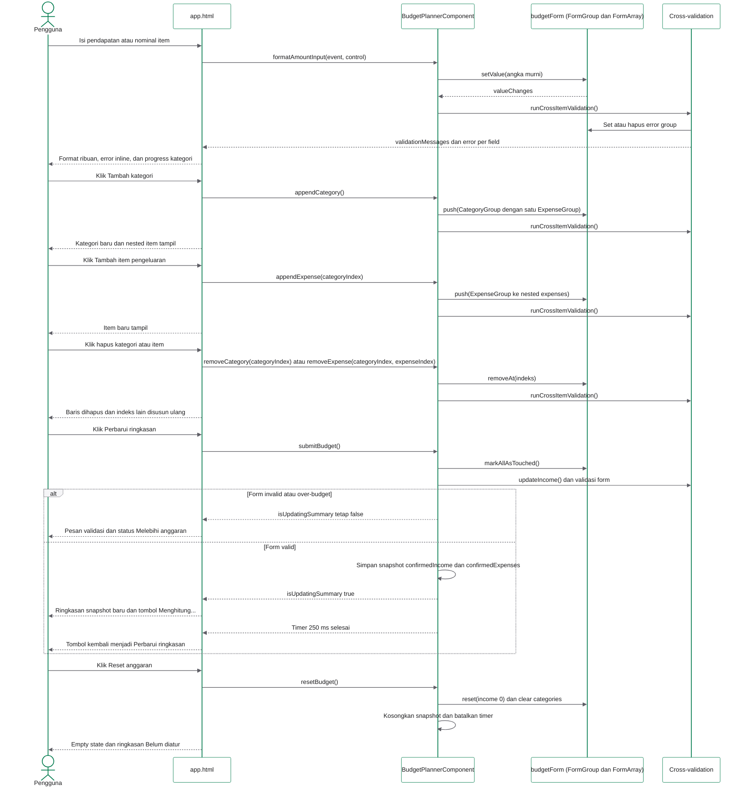

# Sequence Diagram Dynamic Multi-Input dan Cross-Validation

Alur ini menggambarkan interaksi pada browser. Tidak ada request backend atau database. Nama method pada diagram sama dengan nama method di `src/app/app.ts`.

## Catatan sinkronisasi

- Event binding yang terlihat di template: `(input)`, `(blur)`, `(click)`, dan `(ngSubmit)`.
- Handler yang dipanggil: `formatAmountInput()`, `updateIncome()`, `appendCategory()`, `removeCategory()`, `appendExpense()`, `removeExpense()`, `toggleCategory()`, `submitBudget()`, dan `resetBudget()`.
- Validasi dijalankan di Controller melalui `runCrossItemValidation()`, `categoryNamesValidator()`, dan `budgetLimitValidator()`.
- View hanya menampilkan hasil getter dan state controller. Tidak ada perhitungan bisnis di dalam template.
