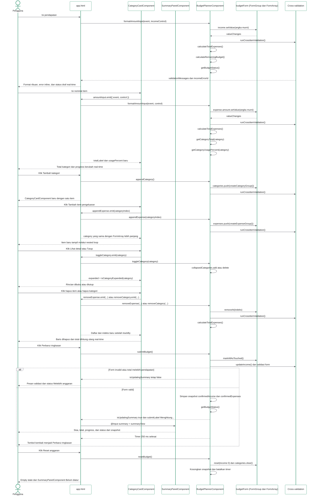

# Sequence Diagram Dynamic Multi-Input dan Cross-Validation

Alur ini menggambarkan interaksi pada browser. Tidak ada request backend atau database. Nama class, method, `@Input`, dan `@Output` pada diagram sama dengan kode di `src/app/`.

## Catatan sinkronisasi

- Komponen View: `app.html` sebagai root, `CategoryCardComponent` untuk satu kategori, dan `SummaryPanelComponent` untuk ringkasan/status.
- Event binding di root: `(input)`, `(blur)`, `(click)`, dan `(ngSubmit)`; event di child diteruskan sebagai `@Output`.
- Handler root: `formatAmountInput()`, `updateIncome()`, `appendCategory()`, `removeCategory()`, `appendExpense()`, `removeExpense()`, `toggleCategory()`, `submitBudget()`, dan `resetBudget()`.
- Kalkulasi real-time: `calculateTotalExpenses()`, `calculateRemainingBudget()`, `getBudgetStatus()`, `getCategoryTotal()`, dan `getCategoryUsagePercent()` dijalankan dari getter root setiap change detection.
- Validasi dijalankan di Controller melalui `runCrossItemValidation()`, `categoryNamesValidator()`, dan `budgetLimitValidator()`.
- View hanya menampilkan hasil getter dan view model. Child component tidak menyimpan state bisnis dan tidak melakukan perhitungan.
