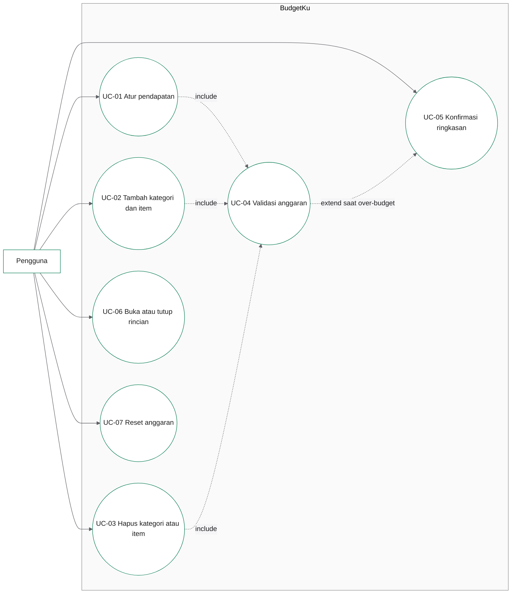

# Use Case Diagram

Dokumen ini adalah sumber diagram yang dapat dirender ke PNG atau PDF menggunakan Mermaid. Diagram menunjukkan aplikasi non-CRUD tanpa aktor backend. ID use case sama dengan `docs/uts/use-case.md`.

## Catatan relasi

- `include` dipakai karena validasi selalu menjadi bagian dari pengisian pendapatan, kategori, dan item.
- `extend` dipakai untuk peringatan over-budget yang memperluas alur konfirmasi ringkasan, tetapi tidak wajib terjadi.
- Tidak ada aktor backend, database, atau service eksternal.
