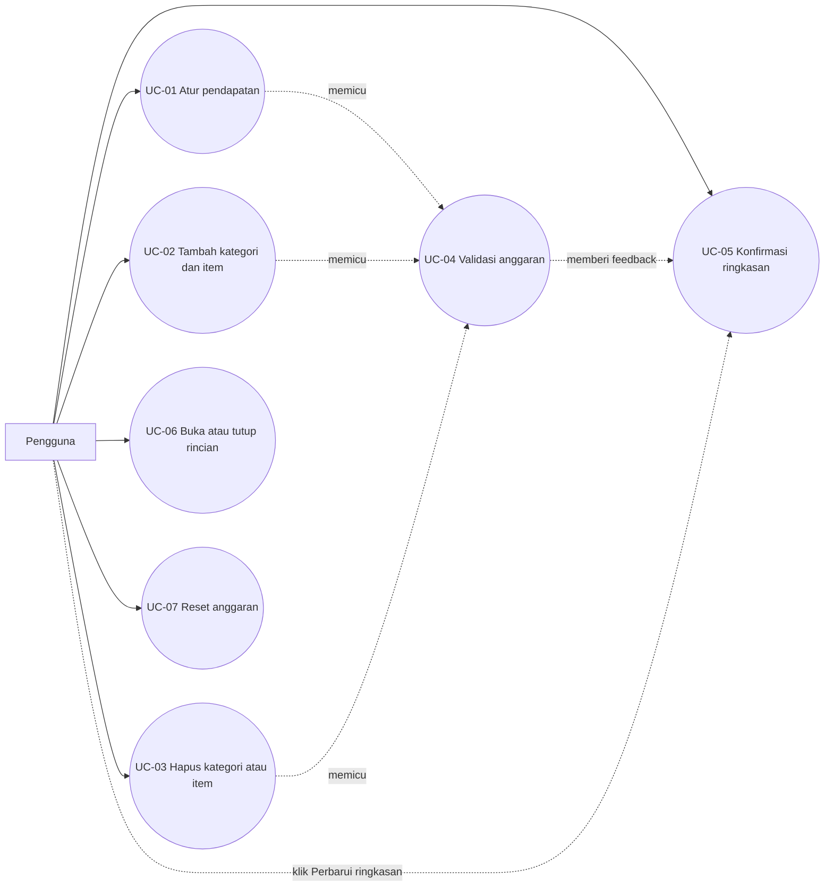

# Use Case BudgetKu

## Aktor

- **Pengguna**: mengatur pendapatan dan rincian pengeluaran bulanannya.

## Daftar use case

| ID | Use case | Hasil |
| --- | --- | --- |
| UC-01 | Mengatur pendapatan bulanan | Nilai income menjadi dasar perhitungan anggaran. |
| UC-02 | Menambah kategori dan item pengeluaran | Satu `CategoryGroup` baru dibuat di `FormArray` dan item dapat ditambahkan ke nested `expenses`. |
| UC-03 | Menghapus kategori atau item pengeluaran | Baris kategori atau item dihapus pada indeks tertentu. |
| UC-04 | Memvalidasi anggaran | Input wajib, nilai minimum, nama kategori duplikat, nama item duplikat, dan over-budget ditampilkan. |
| UC-05 | Mengonfirmasi ringkasan anggaran | Total income, total pengeluaran, sisa, persentase, dan status diperbarui setelah pengguna menekan `Perbarui ringkasan` pada form yang valid. |
| UC-06 | Menyembunyikan rincian kategori | Item kategori dapat ditutup dan dibuka kembali. |
| UC-07 | Mereset anggaran | Form kembali ke income `0` tanpa kategori dan tanpa pesan validasi lama. |

## Diagram use case

## Use case description

### UC-01: Mengatur pendapatan bulanan

| Elemen | Deskripsi |
| --- | --- |
| Nama use case | UC-01 Mengatur pendapatan bulanan |
| Aktor | Pengguna |
| Tujuan | Menentukan batas anggaran bulanan. |
| Precondition | Halaman BudgetKu terbuka dan form `budgetForm` sudah dibuat. |
| Alur utama | 1. Pengguna mengetik nominal pada input `Pendapatan bulanan`. 2. View menjalankan event binding `(input)` dan memanggil `formatAmountInput()`. 3. Controller menyimpan angka murni ke `income` dan menampilkan format ribuan. 4. View menjalankan `(blur)` dan memanggil `updateIncome()`. 5. Controller menandai kontrol sebagai touched dan menjalankan `runCrossItemValidation()`. 6. View menampilkan nilai terformat, pesan validasi bila ada, dan progress kategori yang membaca nilai form. |
| Skenario alternatif | Jika nilai kosong atau `0`, `income` menjadi invalid. Pesan `Pendapatan wajib lebih besar dari Rp0.` tampil setelah kontrol touched atau dirty, dan `submitBudget()` tidak boleh mengonfirmasi ringkasan. |
| Postcondition | Nilai `income` tersimpan di state lokal. Ringkasan belum berubah sampai pengguna menekan `Perbarui ringkasan`. |

### UC-02: Menambah kategori dan item pengeluaran

| Elemen | Deskripsi |
| --- | --- |
| Nama use case | UC-02 Menambah kategori dan item pengeluaran |
| Aktor | Pengguna |
| Tujuan | Menyusun pengeluaran bertingkat dengan kategori dan item. |
| Precondition | Halaman BudgetKu terbuka. |
| Alur utama | 1. Pengguna menekan `Tambah kategori` atau `Tambah kategori pertama`. 2. View menjalankan `(click)` dan memanggil `appendCategory()`. 3. Controller memeriksa batas `maxCategories` lalu mendorong `createCategoryGroup()` ke `categories`. 4. View melakukan re-render dan menampilkan input nama kategori serta satu item awal. 5. Pengguna menekan `Tambah item pengeluaran`. 6. View memanggil `appendExpense(categoryIndex)` dan Controller mendorong `createExpenseGroup()` ke nested `expenses`. 7. `runCrossItemValidation()` dijalankan ulang setelah setiap mutasi. |
| Skenario alternatif | Jika jumlah kategori sudah `10`, `appendCategory()` menolak penambahan dan menampilkan `Maksimal 10 kategori diperbolehkan.` Jika nama kategori atau nama item duplikat, error group dan pesan validasi ditampilkan tanpa menghapus data yang sudah ada. |
| Postcondition | `categories` dan nested `expenses` berisi data baru. Total area kerja berubah, sedangkan snapshot ringkasan tetap sampai dikonfirmasi. |

### UC-03: Menghapus kategori atau item pada indeks tertentu

| Elemen | Deskripsi |
| --- | --- |
| Nama use case | UC-03 Menghapus kategori atau item pengeluaran |
| Aktor | Pengguna |
| Tujuan | Mengurangi baris pengeluaran tanpa merusak indeks dan validasi baris lain. |
| Precondition | Minimal ada satu kategori, dan item yang akan dihapus bukan satu-satunya item dalam kategori. |
| Alur utama | 1. Pengguna menekan tombol hapus kategori atau item. 2. View memanggil `removeCategory(categoryIndex)` atau `removeExpense(categoryIndex, expenseIndex)`. 3. Controller memeriksa indeks, memanggil `removeAt()` pada `FormArray`, lalu menjalankan `runCrossItemValidation()`. 4. View melakukan re-render dengan `trackByCategory` dan `trackByExpense`. |
| Skenario alternatif | Tombol hapus kategori dinonaktifkan saat hanya tersisa satu kategori. Tombol hapus item dinonaktifkan saat hanya tersisa satu item. Indeks di luar rentang diabaikan oleh Controller. |
| Postcondition | Baris terhapus, total dan validasi dihitung ulang, dan snapshot ringkasan tetap sampai dikonfirmasi. |

### UC-04: Memvalidasi anggaran

| Elemen | Deskripsi |
| --- | --- |
| Nama use case | UC-04 Memvalidasi anggaran |
| Aktor | Pengguna |
| Tujuan | Mencegah data tidak lengkap, duplikat, atau melebihi pendapatan. |
| Precondition | Form berisi pendapatan, kategori, dan item. |
| Alur utama | 1. Setiap perubahan nilai memicu `valueChanges`. 2. Controller menjalankan `runCrossItemValidation()`. 3. Controller memeriksa nama kategori duplikat, nama item duplikat per kategori, jumlah item minimal satu, dan total pengeluaran terhadap pendapatan. 4. Pesan disimpan di `validationMessages` dan error group dipasang pada kontrol terkait. 5. View menampilkan pesan inline dan panel validasi. |
| Skenario alternatif | Jika total pengeluaran melebihi pendapatan, panel validasi menampilkan status `Melebihi anggaran` dan pesan `Total pengeluaran tidak boleh melebihi pendapatan bulanan.` `isDraftOverBudget` bernilai benar, tetapi snapshot ringkasan tidak berubah. |
| Postcondition | Kondisi valid atau tidak valid terlihat di area kerja. Ringkasan tetap memakai snapshot terakhir yang valid. |

### UC-05: Mengonfirmasi ringkasan anggaran

| Elemen | Deskripsi |
| --- | --- |
| Nama use case | UC-05 Mengonfirmasi ringkasan anggaran |
| Aktor | Pengguna |
| Tujuan | Memperbarui total, sisa, persentase, dan status ringkasan dari data yang sudah valid. |
| Precondition | Form berisi pendapatan valid, minimal satu kategori, dan item dengan nominal valid. |
| Alur utama | 1. Pengguna menekan `Perbarui ringkasan`. 2. View menjalankan `(ngSubmit)` dan memanggil `submitBudget()`. 3. Controller menjalankan `markAllAsTouched()` dan `updateIncome()`. 4. Jika valid, Controller menyimpan `confirmedIncome` dan `confirmedExpenses` dari nilai form. 5. Controller menyalakan `isUpdatingSummary` selama 250 ms dan View menampilkan `Menghitung...`. 6. Setelah timer selesai, View menampilkan ringkasan dari snapshot dan status `Aman` atau `Mendekati batas`. |
| Skenario alternatif | Jika form invalid atau over-budget, `submitBudget()` langsung kembali tanpa mengubah snapshot dan tanpa menyalakan `Menghitung...`. Pengguna melihat pesan validasi di panel validasi. |
| Postcondition | Snapshot ringkasan berisi data terkonfirmasi terbaru. Perubahan form berikutnya tidak mengubah ringkasan sampai tombol ditekan lagi. |

### UC-07: Mereset anggaran

| Elemen | Deskripsi |
| --- | --- |
| Nama use case | UC-07 Mereset anggaran |
| Aktor | Pengguna |
| Tujuan | Mengembalikan aplikasi ke kondisi awal. |
| Precondition | Halaman BudgetKu terbuka. |
| Alur utama | 1. Pengguna menekan `Reset anggaran`. 2. View memanggil `resetBudget()`. 3. Controller membatalkan timer ringkasan, menghentikan state `Menghitung...`, mereset `budgetForm`, mengosongkan `categories`, dan mengosongkan `validationMessages`. 4. Controller mengembalikan `confirmedIncome` dan `confirmedExpenses` ke `0`. 5. View menampilkan empty state dan ringkasan awal `Belum diatur`. |
| Skenario alternatif | Timer ringkasan yang masih berjalan dibatalkan agar state loading tidak tertinggal setelah reset. |
| Postcondition | Form kosong, tidak ada kategori, tidak ada pesan validasi lama, dan snapshot ringkasan kembali ke nol. |
