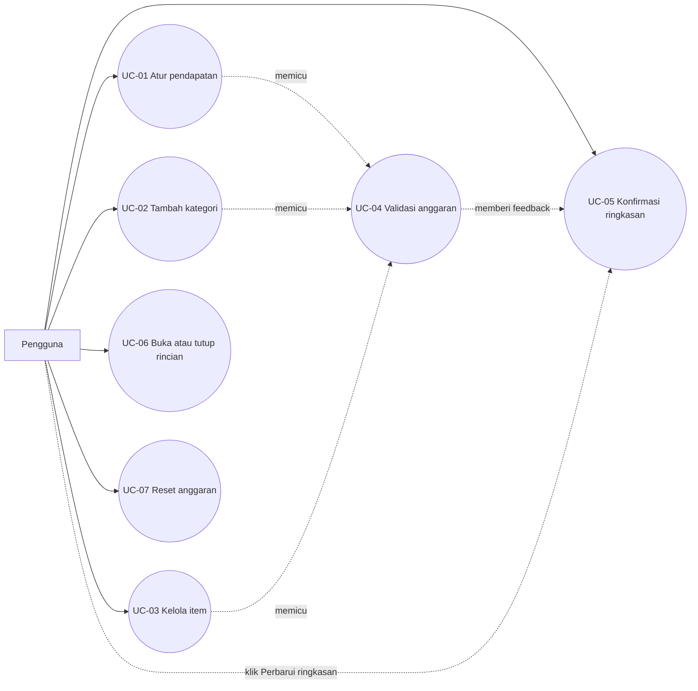

# Use Case BudgetKu

## Aktor

- **Pengguna**: mengatur pendapatan dan rincian pengeluaran bulanannya.

## Daftar use case

| ID | Use case | Hasil |
| --- | --- | --- |
| UC-01 | Mengatur pendapatan bulanan | Nilai income menjadi dasar perhitungan anggaran. |
| UC-02 | Menambah kategori pengeluaran | Satu `CategoryGroup` baru dibuat di `FormArray`. |
| UC-03 | Mengelola item pengeluaran | Pengguna dapat menambah atau menghapus `ExpenseGroup` di kategori. |
| UC-04 | Memvalidasi anggaran | Input wajib, nilai minimum, nama kategori duplikat, dan over-budget ditampilkan. |
| UC-05 | Mengonfirmasi ringkasan anggaran | Total income, total pengeluaran, sisa, persentase, dan status diperbarui setelah pengguna menekan `Perbarui ringkasan` pada form yang valid. |
| UC-06 | Menyembunyikan rincian kategori | Item kategori dapat ditutup dan dibuka kembali. |
| UC-07 | Mereset anggaran | Form kembali ke income `0` tanpa kategori dan tanpa pesan validasi lama. |

## Diagram use case

