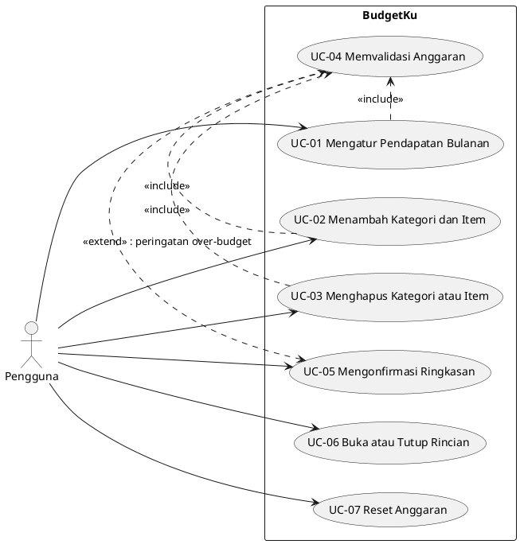
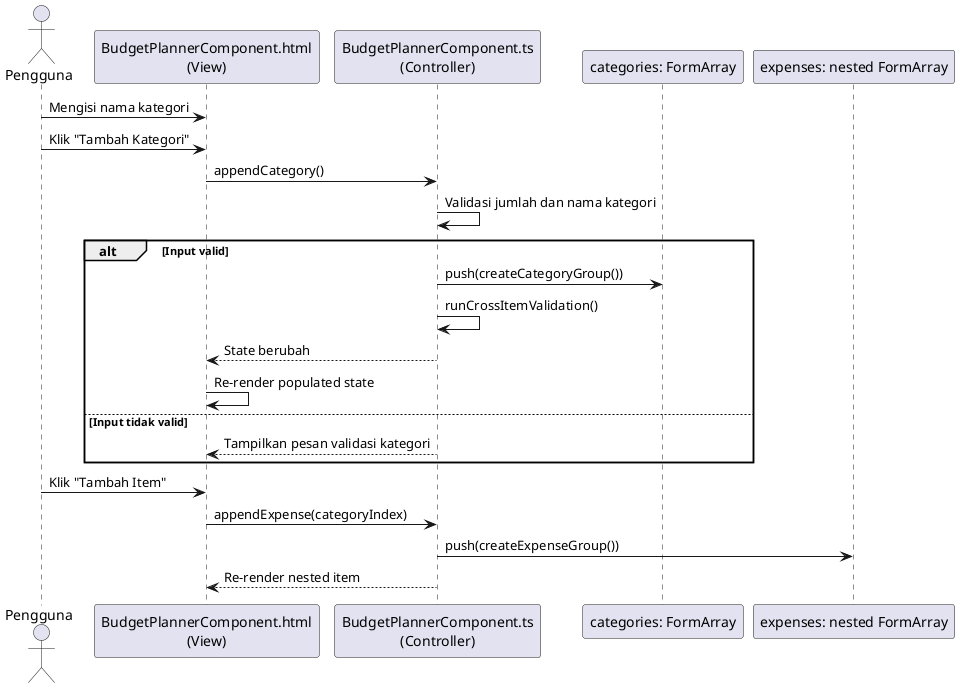
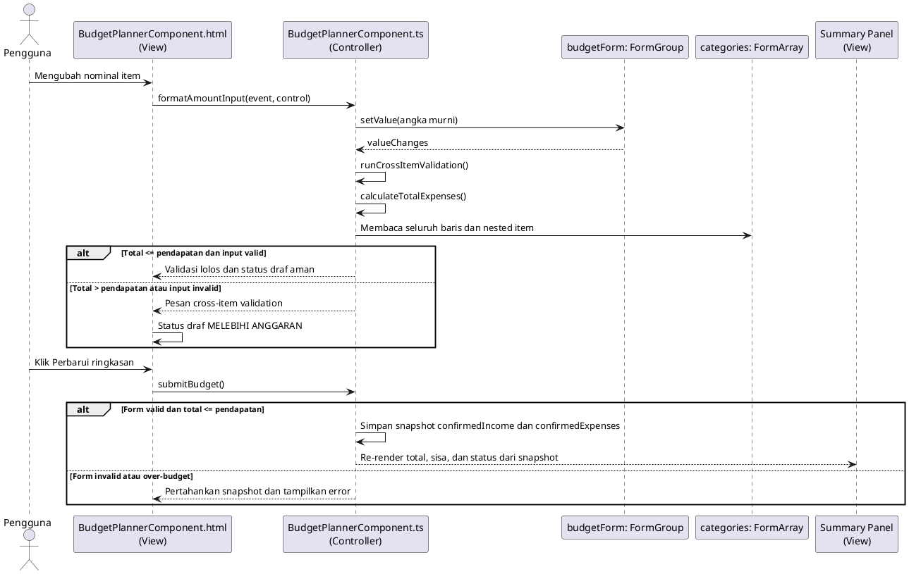

# PROJECT UTS FBP: BUDGETKU

## Dokumen Proyek Final

Dokumen ini adalah rancangan proyek yang akan diimplementasikan untuk memenuhi ketentuan UTS Framework Based Programming. Proyek yang dipilih adalah **BudgetKu: Aplikasi Perencana Anggaran Bulanan**.

Implementasi wajib menggunakan Angular dengan fokus pada **View (HTML Template)** dan **Controller (Component TypeScript)**. Data hanya disimpan di memory menggunakan `FormGroup`, `FormArray`, dan state lokal. Backend API, database, login, dan persistence tidak digunakan.

## 1. Informasi Ujian

- **Perguruan tinggi:** Jakarta Global University (JGU)
- **Mata kuliah:** Framework Based Programming
- **Dosen:** Halimatuz Zuhriyah, S.Kom., MIT
- **Jurusan:** Teknik Informatika
- **Tahun akademik:** Ganjil 2026/2027
- **Hari/tanggal:** Senin, 2 November 2026
- **Waktu pengerjaan:** 5 hari
- **Sifat ujian:** Project individu

## 2. Tujuan dan Batasan

Buat aplikasi web interaktif menggunakan Angular dengan fokus pada interaksi **View (HTML Template)** dan **Controller (Component TypeScript)**.

Lapisan backend berikut belum diwajibkan:

- Backend API
- Database
- Persistence atau penyimpanan permanen
- Model backend

Data cukup dikelola sebagai state atau array lokal di memory selama aplikasi berjalan.

Ketentuan umum:

1. Ide aplikasi bebas, tetapi harus interaktif dan bukan CRUD statis biasa.
2. Aplikasi harus memiliki input dinamis dengan beberapa baris atau nilai.
3. Nama class, property, method handler, dan pesan pada kode harus konsisten 100% dengan Sequence Diagram.
4. Aplikasi harus mampu menangani edge case, seperti tambah banyak baris, hapus indeks acak, duplikasi, batas minimum/maksimum, dan total yang tidak valid.
5. Aplikasi harus dapat didemonstrasikan serta dipertanggungjawabkan melalui wawancara teknis.

## 3. Deliverable

### 3.1 Studi Kasus dan Use Case Diagram

Ajukan ide aplikasi interaktif non-CRUD dan buat Use Case Diagram yang mencakup:

- Aktor sistem.
- Batas sistem.
- Fungsionalitas utama.
- Relasi `include` dan `extend` jika diperlukan.
- Hubungan aktor dengan use case.

**Output:** laporan dan diagram dalam format `.pdf` atau `.png`.

### 3.2 Use Case Description

Jabarkan minimal **3 use case utama** dalam tabel. Setiap use case harus memuat:

- Nama use case.
- Aktor.
- Tujuan.
- Precondition.
- Alur aksi–reaksi utama, termasuk event binding View, pemanggilan handler Controller, dan perubahan tampilan.
- Skenario alternatif ketika validasi input gagal.
- Postcondition.

Use case harus menggambarkan proses dinamis, bukan hanya membuka halaman atau menampilkan data statis.

**Output:** laporan dan diagram dalam format `.pdf` atau `.png`.

### 3.3 Sequence Diagram

Diagram harus menggambarkan alur **View–Controller** secara ketat:

1. Pengguna berinteraksi dengan elemen HTML.
2. View menjalankan event binding.
3. View memanggil handler atau method Component TypeScript.
4. Controller memvalidasi input.
5. Controller memutasi `FormArray` atau array lokal di memory.
6. Controller melakukan kalkulasi real-time jika diperlukan.
7. Controller memperbarui state.
8. Angular melakukan re-render data ke View.
9. View menampilkan data, pesan validasi, empty state, atau populated state.

Jangan memasukkan database, backend API, repository, atau persistence layer.

**Output:** laporan dan Sequence Diagram dalam format `.pdf` atau `.png`.

### 3.4 Component Architecture dan Data Mapping

Buat pemetaan arsitektur Angular yang menjelaskan:

- Component Tree atau hierarki komponen.
- Tanggung jawab setiap komponen.
- Pemetaan elemen View ke property atau method Controller.
- Alur data antarkomponen.
- Penggunaan `@Input`, `@Output`, `EventEmitter`, atau UI State Service jika diperlukan.

Contoh tabel:

| Elemen View | Property/Method Controller | Interaksi | Dampak state |
|---|---|---|---|
| Tombol tambah | `appendItem()` | `(click)` | Menambah item ke `FormArray` |
| Tombol hapus | `removeItem(index)` | `(click)` | Menghapus item pada indeks tertentu |
| Input nilai | `items.at(index)` | `formControlName` | Mengubah nilai input |
| Ringkasan total | `totalValue` | Interpolasi | Menampilkan kalkulasi terbaru |

**Output:** source code Angular, struktur komponen, dan pemetaan arsitektur.

### 3.5.1 FormArray Dinamis dan Cross-Validation

Implementasikan `FormArray` dinamis dengan kemampuan:

- Menambah baris baru atau **append**.
- Menghapus baris pada indeks tertentu atau **remove at index**.
- Memiliki input bertingkat atau nested items.
- Memvalidasi input setiap baris.
- Memvalidasi hubungan antarbaris atau **cross-item validation**.

Contoh aturan cross-validation:

- Tidak boleh ada nilai duplikat antarbaris.
- Akumulasi persentase harus tepat 100%.
- Total kuota tidak boleh melebihi batas.
- Jumlah baris harus berada di antara batas minimum dan maksimum.
- Setiap baris harus memiliki minimal satu sub-item.

**Output:** source code Angular di GitHub atau ZIP.

### 3.5.2 `*ngFor` atau `@for` Tingkat Lanjut

Wajib mengimplementasikan:

- Context variable `index` untuk penomoran atau identitas kontrol.
- Context variable `first` dan `last` untuk mengatur tombol aksi pada baris pertama atau terakhir.
- Fungsi `trackBy` kustom pada Controller untuk optimasi rendering DOM.
- Nested loop untuk data relasional atau sub-item.

Contoh:

```html
<div *ngFor="let item of items.controls; let index = index; let first = first; let last = last; trackBy: trackByItem">
  <span>{{ index + 1 }}</span>

  <div *ngFor="let subItem of getSubItems(item); let subIndex = index">
    {{ subIndex + 1 }}. {{ subItem.name }}
  </div>

  <button *ngIf="!first" type="button">Aksi baris</button>
  <button *ngIf="!last" type="button">Aksi berikutnya</button>
</div>
```

Sintaks Angular modern `@for` boleh digunakan sebagai pengganti `*ngFor`; persyaratan `index`, `first`, `last`, `track`, dan nested loop tetap berlaku.

### 3.5.3 `*ngIf` atau `@if` dan UI State

Gunakan **Template Branching** untuk memisahkan:

- Empty State ketika data kosong.
- Populated State ketika data tersedia.

Gunakan `ng-template` dengan `#else` atau `#then`, atau sintaks `@if` pada Angular modern.

Logika boolean kompleks wajib berada pada getter atau method Controller, bukan ekspresi panjang di HTML.

Contoh:

```html
<ng-container *ngIf="hasItems; else emptyState">
  <app-item-list [items]="items"></app-item-list>
</ng-container>

<ng-template #emptyState>
  <p>Belum ada data.</p>
</ng-template>
```

```ts
get hasItems(): boolean {
  return this.items.length > 0;
}
```

### 3.6 Presentasi dan Technical Code Defense

Demonstrasikan aplikasi dan uji:

- Tambah satu dan banyak baris.
- Hapus baris pertama, tengah, terakhir, dan indeks acak.
- Input duplikat.
- Total atau akumulasi tidak valid.
- Batas minimum dan maksimum baris.
- Nested items.
- Perubahan empty state menjadi populated state.
- Kalkulasi real-time.

Jelaskan hubungan antara Use Case Diagram, Use Case Description, Sequence Diagram, Component Tree, Template HTML, dan Component TypeScript.

## 4. Alur Implementasi yang Harus Terlihat

```text
User input
  → event binding pada Template
  → handler Component
  → validasi dan mutasi FormArray/array lokal
  → kalkulasi atau perubahan UI state
  → re-render Template
```

## 5. Checklist Pengumpulan

### Dokumen dan diagram

- [ ] Nama dan NPM ditulis lengkap.
- [ ] Ide aplikasi interaktif dan bukan CRUD statis.
- [ ] Use Case Diagram memiliki aktor dan fungsi utama.
- [ ] Relasi `include` dan `extend` tepat jika digunakan.
- [ ] Minimal 3 Use Case Description tersedia.
- [ ] Setiap use case memiliki precondition, alur utama, skenario alternatif, dan postcondition.
- [ ] Sequence Diagram hanya memodelkan View–Controller.
- [ ] Nama method diagram sama dengan nama method pada kode.
- [ ] Component Tree dan tabel data mapping tersedia.

### Source code Angular

- [ ] `FormArray` digunakan untuk input dinamis.
- [ ] Fungsi append baris tersedia.
- [ ] Fungsi remove berdasarkan indeks tersedia.
- [ ] Nested items tersedia.
- [ ] Cross-item validation tersedia dan diuji.
- [ ] Context variable `index`, `first`, dan `last` digunakan.
- [ ] Fungsi `trackBy` kustom tersedia di Controller.
- [ ] Nested loop tersedia.
- [ ] Empty State dan Populated State dipisahkan dengan branching template.
- [ ] Logika boolean kompleks berada di getter atau method Controller.
- [ ] Tidak ada ketergantungan pada backend atau database.
- [ ] Aplikasi berhasil build dan berjalan tanpa error.

### Demo

- [ ] Skenario normal berhasil.
- [ ] Skenario edge case berhasil.
- [ ] Penghapusan indeks acak tidak merusak form atau validasi.
- [ ] Pesan validasi lintas-baris jelas.
- [ ] Diagram dan source code sinkron 100%.
- [ ] Semua handler dapat dijelaskan saat technical defense.

## 6. Bobot Penilaian

| Komponen | Bobot |
|---|---:|
| Proposal dan Use Case Diagram | 10% |
| Use Case Description | 10% |
| Sequence Diagram View–Controller | 15% |
| Component Architecture dan Data Mapping | 10% |
| FormArray dan Cross-Validation | 15% |
| `*ngFor`/`@for`, context variable, nested loop, dan `trackBy` | 15% |
| `*ngIf`/`@if` dan UI State Management | 10% |
| Presentasi dan Technical Code Defense | 15% |
| **Total** | **100%** |

## 7. Rekomendasi Studi Kasus

Pilih satu studi kasus yang memiliki entitas bertingkat dan aturan hubungan antarbaris, misalnya:

- Penyusun jadwal kegiatan dengan pembagian durasi.
- Perancang paket perjalanan dengan destinasi dan aktivitas.
- Penyusun menu katering dengan paket dan komposisi item.
- Perencana anggaran acara dengan kategori dan alokasi persentase.

Studi kasus harus memiliki alasan jelas untuk menggunakan `FormArray`, nested items, dan cross-item validation. Jangan menambahkan backend atau service state jika satu Component sudah cukup memenuhi kebutuhan tugas.

## 8. Spesifikasi Proyek BudgetKu

### 8.1 Deskripsi Aplikasi

**BudgetKu** adalah aplikasi perencana anggaran bulanan untuk membantu pengguna mengatur pendapatan, kategori pengeluaran, dan item belanja. Total area kerja dan validasi mengikuti input terbaru, sedangkan panel ringkasan menampilkan hasil yang sudah dikonfirmasi.

Aplikasi ini dipilih karena relevan dengan kegiatan sehari-hari dan secara alami membutuhkan input bertingkat:

```text
Anggaran Bulanan
├── Pendapatan
├── Kategori: Kebutuhan Rumah
│   ├── Listrik
│   └── Air
├── Kategori: Transportasi
│   ├── Bensin
│   └── Parkir
└── Kategori: Makanan
    ├── Belanja Mingguan
    └── Makan di Luar
```

Fokus aplikasi adalah View dan Controller Angular. Tidak ada backend API, database, login, atau penyimpanan permanen.

### 8.2 Aktor dan Fitur

**Aktor:** Pengguna.

Fitur utama:

1. Memasukkan pendapatan bulanan.
2. Menambahkan kategori pengeluaran.
3. Menghapus kategori pada indeks tertentu.
4. Menambahkan item pengeluaran ke dalam kategori.
5. Menghapus item pada indeks tertentu.
6. Menghitung total pengeluaran area kerja dari nilai form terbaru.
7. Mengonfirmasi ringkasan total, sisa, pemakaian, dan status hanya saat tombol `Perbarui ringkasan` ditekan dan form valid.
8. Menampilkan status draf `Melebihi anggaran` saat total form melampaui pendapatan, tanpa mengubah ringkasan terkonfirmasi.
9. Menampilkan Empty State saat belum ada kategori.
10. Menampilkan Populated State saat kategori telah tersedia.

### 8.3 Use Case yang Wajib Dibuat

#### UC-01: Mengisi Pendapatan Bulanan

| Elemen | Deskripsi |
|---|---|
| Aktor | Pengguna |
| Tujuan | Menentukan batas anggaran bulanan |
| Precondition | Halaman BudgetKu terbuka |
| Alur utama | Pengguna mengisi input pendapatan → View menjalankan `(input)` dan memanggil `formatAmountInput()` → Controller menyimpan angka murni ke `income` → View menjalankan `(blur)` dan memanggil `updateIncome()` → Controller memvalidasi nilai dan memperbarui feedback form |
| Alternatif | Jika kosong atau kurang dari atau sama dengan 0, Controller menampilkan pesan validasi dan `submitBudget()` tidak boleh mengonfirmasi ringkasan |
| Postcondition | Pendapatan valid tersimpan pada state lokal. Area kerja dan progress kategori mengikuti nilai form, sedangkan ringkasan tetap memakai snapshot sampai dikonfirmasi |

#### UC-02: Mengelola Kategori dan Item Pengeluaran

| Elemen | Deskripsi |
|---|---|
| Aktor | Pengguna |
| Tujuan | Menambah dan menghapus data pengeluaran bertingkat |
| Precondition | Pendapatan telah diisi atau pengguna membuka form pengeluaran |
| Alur utama | Pengguna menekan tambah kategori → View memanggil `appendCategory()` → Controller menambah group ke `categories` → pengguna menambah item → View memanggil `appendExpense(categoryIndex)` → Controller menambah item ke nested `FormArray` → View melakukan re-render |
| Alternatif | Jika nama kategori duplikat, nominal tidak valid, atau item duplikat dalam kategori yang sama, Controller menampilkan error dan mempertahankan data valid sebelumnya |
| Postcondition | Data kategori dan item tersimpan pada nested `FormArray`, total area kerja dihitung ulang, sedangkan snapshot ringkasan tetap sampai dikonfirmasi |

#### UC-03: Mengonfirmasi Ringkasan Anggaran

| Elemen | Deskripsi |
|---|---|
| Aktor | Pengguna |
| Tujuan | Mengetahui total pengeluaran, sisa anggaran, dan status dari data yang sudah valid |
| Precondition | Controller memiliki pendapatan valid, minimal satu kategori, dan item dengan nominal valid |
| Alur utama | Pengguna menekan `Perbarui ringkasan` → View menjalankan `(ngSubmit)` dan memanggil `submitBudget()` → Controller menjalankan `markAllAsTouched()` dan `updateIncome()` → jika valid, Controller menyimpan snapshot `confirmedIncome` dan `confirmedExpenses` → View menampilkan total, sisa, pemakaian, dan status dari snapshot |
| Alternatif | Jika belum ada kategori, View menampilkan Empty State. Jika total pengeluaran melebihi pendapatan, panel validasi menampilkan `Melebihi anggaran` dan snapshot ringkasan tidak berubah |
| Postcondition | Pengguna melihat ringkasan yang sesuai dengan data terkonfirmasi terakhir |

### 8.4 Rancangan FormArray

Gunakan nested `FormArray` dengan bentuk berikut:

```text
budgetForm: FormGroup
├── income: FormControl<number>
└── categories: FormArray<FormGroup>
    ├── name: FormControl<string>
    └── expenses: FormArray<FormGroup>
        ├── name: FormControl<string>
        └── amount: FormControl<number>
```

Method minimum yang harus sinkron antara kode dan Sequence Diagram:

```ts
updateIncome()
appendCategory()
removeCategory(categoryIndex: number)
appendExpense(categoryIndex: number)
removeExpense(categoryIndex: number, expenseIndex: number)
calculateTotalExpenses()
calculateRemainingBudget()
getBudgetStatus()
trackByCategory(index: number, category: AbstractControl)
trackByExpense(index: number, expense: AbstractControl)
```

Nama method dapat diubah, tetapi setelah dipilih harus digunakan konsisten pada Template, Component TypeScript, Use Case Description, dan Sequence Diagram.

### 8.5 Aturan Validasi

Validasi field:

- `income` wajib diisi dan harus lebih besar dari 0.
- Nama kategori wajib diisi.
- Nama item wajib diisi.
- Nominal item harus lebih besar dari 0.
- Setiap kategori harus memiliki minimal satu item.

Validasi lintas-baris:

- Nama kategori tidak boleh duplikat.
- Nama item tidak boleh duplikat dalam kategori yang sama.
- Total pengeluaran tidak boleh melebihi pendapatan.
- Jumlah kategori minimal 1 dan maksimal 10.
- Total nominal item menjadi dasar total nominal kategori dan total pengeluaran.

Validasi harus dijalankan di Controller, bukan melalui logika panjang di HTML.

### 8.6 Pemetaan Komponen

Component Tree yang direkomendasikan:

```text
BudgetPlannerComponent
├── BudgetInputComponent
├── CategoryFormComponent
│   └── ExpenseItemComponent
└── BudgetSummaryComponent
```

Untuk implementasi minimal, semua fitur boleh berada pada `BudgetPlannerComponent`. Jika komponen dipisah, gunakan pemetaan berikut:

| Komponen | Tanggung jawab | Komunikasi |
|---|---|---|
| `BudgetPlannerComponent` | Menyimpan `FormGroup`, validasi, mutasi state, dan kalkulasi | Parent state |
| `BudgetInputComponent` | Menampilkan input pendapatan | `@Input` dan `@Output` |
| `CategoryFormComponent` | Menampilkan kategori dan nested item | `@Input`, `@Output`, `EventEmitter` |
| `ExpenseItemComponent` | Menampilkan satu item pengeluaran | `@Input` |
| `BudgetSummaryComponent` | Menampilkan total, sisa, dan status anggaran | `@Input` |

### 8.7 Persyaratan Template Angular

Template harus menunjukkan seluruh fitur berikut:

```html
<div *ngFor="let category of categories.controls; let categoryIndex = index; let first = first; let last = last; trackBy: trackByCategory">
  <span>Kategori {{ categoryIndex + 1 }}</span>

  <div *ngFor="let expense of getExpenses(category).controls; let expenseIndex = index; trackBy: trackByExpense">
    <span>Item {{ expenseIndex + 1 }}</span>
  </div>

  <button *ngIf="!first" type="button">Aksi kategori</button>
  <button *ngIf="!last" type="button">Aksi berikutnya</button>
</div>
```

Implementasi aktual harus menghubungkan tombol tersebut dengan handler yang benar, bukan placeholder.

Gunakan Template Branching untuk empty dan populated state:

```html
<ng-container *ngIf="hasCategories; else emptyCategories">
  <!-- populated state -->
</ng-container>

<ng-template #emptyCategories>
  <p>Belum ada kategori pengeluaran.</p>
</ng-template>
```

Getter yang disarankan:

```ts
get hasCategories(): boolean {
  return this.categories.length > 0;
}
```

### 8.8 Skenario Live Demo

Urutan demo minimum:

1. Buka aplikasi dan tunjukkan Empty State.
2. Masukkan pendapatan bulanan yang valid.
3. Tambahkan tiga kategori.
4. Tambahkan beberapa item pada setiap kategori.
5. Tunjukkan nested loop dan penomoran `index`.
6. Hapus kategori pertama, kategori tengah, dan kategori terakhir.
7. Hapus item pada indeks acak.
8. Masukkan nama kategori duplikat.
9. Masukkan item duplikat dalam kategori yang sama.
10. Ubah nominal sampai total pengeluaran melebihi pendapatan.
11. Tunjukkan perubahan total area kerja, pesan validasi, dan status draf secara langsung, lalu tekan `Perbarui ringkasan` dan tunjukkan angka ringkasan baru.
12. Jelaskan bahwa seluruh data hanya berada pada state lokal dan tidak memakai database.

### 8.9 Pemetaan BudgetKu terhadap Rubrik

| Ketentuan | Implementasi BudgetKu |
|---|---|
| Ide non-CRUD dan interaktif | Perencanaan anggaran dengan kalkulasi area kerja dan ringkasan terkonfirmasi |
| Minimal 3 use case | Mengatur pendapatan, mengelola kategori dan item, mengonfirmasi ringkasan |
| Sequence View–Controller | Event binding → handler → validasi/mutasi → re-render |
| Component Tree | Planner, input, category form, expense item, summary |
| FormArray dinamis | `categories` dan nested `expenses` |
| Append dan remove at index | `appendCategory()`, `removeCategory()`, `appendExpense()`, `removeExpense()` |
| Cross-item validation | Duplikasi kategori, duplikasi item, batas kategori, dan total terhadap pendapatan |
| `index`, `first`, `last` | Digunakan pada loop kategori dan item |
| `trackBy` kustom | `trackByCategory()` dan `trackByExpense()` |
| Nested loop | Loop kategori lalu loop item pengeluaran |
| Empty/Populated State | `hasCategories` dan `ng-template #emptyCategories` |
| UI state | `Belum diatur`, `Aman`, `Mendekati batas`, status draf `Melebihi anggaran`, empty, validation, dan `Menghitung...` |
| Clean Code | Evaluasi kompleks berada pada getter/method Controller |
| Technical defense | Demo edge case dan sinkronisasi diagram dengan kode |

## 9. Sumber Diagram untuk Laporan

Diagram berikut dapat dirender menggunakan PlantUML, lalu diekspor menjadi `.png` atau dimasukkan ke laporan `.pdf`.

### 9.1 Use Case Diagram



Catatan: relasi `<<extend>>` pada konfirmasi ringkasan dipakai saat peringatan over-budget muncul. Relasi `<<include>>` dipakai untuk proses yang selalu menjadi bagian dari use case utama. Sumber yang dipakai laporan ada di `docs/uts/use-case-diagram.md` dengan ID yang sama.

### 9.2 Sequence Diagram: Menambah Kategori dan Item



### 9.3 Sequence Diagram: Validasi dan Konfirmasi Ringkasan



## 10. Pemetaan Nama Kode dan Diagram

Nama berikut harus dipakai sama persis pada Sequence Diagram, Component TypeScript, dan HTML Template:

| Nama | Jenis | Fungsi |
|---|---|---|
| `budgetForm` | `FormGroup` | Form utama anggaran |
| `income` | `FormControl` | Pendapatan bulanan |
| `categories` | `FormArray` | Daftar kategori pengeluaran |
| `expenses` | Nested `FormArray` | Daftar item dalam kategori |
| `appendCategory()` | Handler | Menambah kategori |
| `removeCategory(categoryIndex)` | Handler | Menghapus kategori berdasarkan indeks |
| `appendExpense(categoryIndex)` | Handler | Menambah item pada kategori |
| `removeExpense(categoryIndex, expenseIndex)` | Handler | Menghapus item berdasarkan indeks |
| `toggleCategory(category)` | Handler | Menutup atau membuka rincian kategori |
| `formatAmountInput(event, control)` | Handler | Menyimpan angka murni dan menampilkan format ribuan |
| `updateIncome()` | Handler | Menandai income touched dan memvalidasi |
| `submitBudget()` | Handler | Mengonfirmasi snapshot ringkasan bila form valid |
| `resetBudget()` | Handler | Mengosongkan form, validasi, dan snapshot |
| `runCrossItemValidation()` | Validator | Menjalankan validasi lintas baris |
| `calculateTotalExpenses()` | Calculation method | Menghitung total semua item |
| `calculateRemainingBudget()` | Calculation method | Menghitung pendapatan dikurangi pengeluaran |
| `getBudgetStatus()` | Getter/method | Menentukan status anggaran |
| `hasCategories` | Getter | Menentukan Empty atau Populated State |
| `trackByCategory()` | `trackBy` method | Optimasi loop kategori |
| `trackByExpense()` | `trackBy` method | Optimasi loop item |

## 11. Kriteria Penerimaan Proyek

Proyek dianggap memenuhi ketentuan apabila seluruh kondisi berikut terpenuhi:

1. Angular dapat menjalankan aplikasi tanpa error build.
2. Pendapatan dapat dimasukkan dan divalidasi.
3. Kategori dapat ditambah dan dihapus pada indeks tertentu.
4. Item pengeluaran dapat ditambah dan dihapus pada indeks tertentu.
5. Nested `FormArray` benar-benar digunakan, bukan array statis atau input hardcoded.
6. Nama kategori duplikat ditolak.
7. Nama item duplikat dalam kategori yang sama ditolak.
8. Nominal kosong, nol, atau negatif ditolak.
9. Total pengeluaran area kerja mengikuti nilai form, dan ringkasan berubah setelah `Perbarui ringkasan` pada form valid.
10. Total pengeluaran yang melebihi pendapatan menghasilkan status dan pesan peringatan.
11. Jumlah kategori dibatasi maksimal 10 dan tidak menghapus baris secara tidak aman.
12. Loop menggunakan `index`, `first`, `last`, dan `trackBy` kustom.
13. Nested loop menampilkan item pada setiap kategori.
14. Empty State dan Populated State menggunakan template branching.
15. Ekspresi boolean kompleks tidak ditulis langsung di HTML.
16. Tidak ada database atau backend API.
17. Semua nama method pada kode sama dengan nama pada diagram.
18. Skenario live demo dapat dijalankan tanpa mengubah kode saat presentasi.

## 12. Urutan Pengerjaan

1. Buat project Angular bernama `budgetku`.
2. Buat `BudgetPlannerComponent` sebagai Controller utama.
3. Buat `budgetForm` dengan `income` dan nested `categories`.
4. Buat factory method untuk category group dan expense group.
5. Implementasikan `appendCategory()` dan `removeCategory()`.
6. Implementasikan `appendExpense()` dan `removeExpense()`.
7. Implementasikan validasi field dan cross-item validation.
8. Implementasikan kalkulasi total, sisa, dan status.
9. Implementasikan template `*ngFor`/`@for`, `index`, `first`, `last`, nested loop, dan `trackBy`.
10. Implementasikan Empty State dan Populated State dengan `ng-template` atau `@if`.
11. Uji edge case sesuai skenario live demo.
12. Gambar ulang atau render diagram PlantUML di atas untuk laporan.
13. Periksa konsistensi nama antara kode, laporan, dan diagram.
14. Build aplikasi dan siapkan source code dalam GitHub atau ZIP.

## 13. Batasan Implementasi

- Tidak membuat login.
- Tidak membuat backend.
- Tidak membuat database.
- Tidak membuat fitur yang tidak terkait perencanaan anggaran.
- Tidak menggunakan data hardcoded sebagai pengganti `FormArray` dinamis.
- Tidak menulis validasi utama hanya di template.
- Tidak menambahkan service atau komponen tambahan jika tidak diperlukan.

Tujuan minimum adalah aplikasi BudgetKu yang bekerja lengkap pada View–Controller. Fitur penyimpanan permanen dapat ditambahkan hanya jika dosen meminta, karena tidak termasuk ketentuan utama PDF.

## 14. Catatan Arah Desain

- **Palet:** putih dan abu-abu netral menjadi permukaan kerja agar form mudah dipindai; hijau `#007a4d` menjadi satu aksen untuk tindakan dan kondisi aman; merah `#b42318` hanya untuk kesalahan.
- **Tipografi:** system font stack dipakai karena tersedia di perangkat pengguna tanpa memblokir rendering font eksternal.
- **Layout:** pendapatan menjadi titik awal, kategori menjadi area kerja utama, dan ringkasan menjadi pendamping yang menempel di desktop. Di tablet ringkasan naik ke atas, dan di mobile semua menjadi satu kolom.
- **Kartu:** border tipis dan ruang memisahkan kelompok data. Tidak ada shadow dekoratif agar hierarki tetap jelas.
- **Ruang:** jarak lebih besar digunakan di antara bagian utama, sedangkan input dalam satu kategori dibuat rapat agar hubungan datanya terlihat.
- **Motion:** hanya transisi hover, focus, dan progress yang dipakai. Semua gerak berhenti saat `prefers-reduced-motion: reduce`.
- **Ikon status:** `?` untuk `Belum diatur`, `✓` untuk kondisi aman, dan `!` untuk peringatan. Tidak ada dot dekoratif tanpa makna.
- **Responsive:** pada layar kecil, ringkasan ditumpuk dan tombol dibuat selebar container agar tetap mudah disentuh.
- **Tema:** hanya mode terang karena aplikasi ini dipakai untuk memasukkan dan membandingkan angka dalam waktu singkat; tidak ada toggle tema yang setengah jadi.
- **Referensi visual:** editorial dan utilitarian, bukan penyalinan layout atau identitas produk lain.
